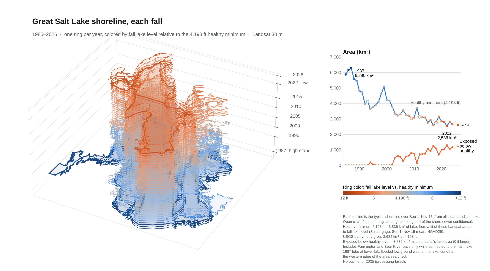

# Great Salt Lake shorelines, 1985–2026

Fall shorelines of Great Salt Lake mapped from Landsat imagery, stacked into a
3D figure and compared with the lake's 4,198 ft minimum healthy level.



**[Open the interactive, rotatable version](https://joshlemonte.github.io/great-salt-lake-shorelines/)** in your browser
(no download needed). The source file is
[`figures/output/gsl_shorelines_interactive.html`](figures/output/gsl_shorelines_interactive.html).

## What is here

| Path | Contents |
|---|---|
| `arcgis/gsl_landsat_outlines_arcpy.py` | ArcGIS Pro script that maps one fall shoreline per year from Landsat |
| `arcgis/gsl_dem_bathtub_levels.py` | Earlier alternative: "bathtub" outlines at set lake levels from a lakebed DEM |
| `data/outlines/GSL_Landsat_outlines.shp` | Shoreline polygons, one per year (UTM 12N, WGS 84) |
| `data/outlines/GSL_Landsat_scenes.csv` | Landsat scenes used for each year, with cloud cover |
| `data/fall_levels_and_usgs_areas.csv` | Fall lake level at the Saltair gage and the USGS bathymetric area at that level |
| `figures/scripts/` | Python that builds the static PNG and the interactive page from the shapefile |
| `figures/output/` | The finished figures |
| `figures/page_text.md` | The interactive page's full explanatory text (introduction, method notes, repairs and limits), kept out of the page itself |

## Method

**Imagery.** Landsat Collection 2 Level-2 surface reflectance (Landsat 4, 5, 7, 8, 9)
from the Esri Living Atlas "Landsat Level-2" imagery layer. It needs an ArcGIS
Online organizational account and does not use credits.

**One outline per fall (September 1 to November 15).**
1. Scenes over the lake are ordered from least to most cloudy. Landsat 7 is used only
   in 2012, or to fill gaps, because of its scan-line stripes.
2. Cloud, cloud shadow, cirrus and fill pixels are masked from the Pixel QA band.
3. MNDWI = (green − SWIR1) / (green + SWIR1) is computed, and water is classified
   with an Otsu threshold set separately for each scene.
4. A pixel counts as water if it was water in at least half of its clear looks.
5. Only water connected to seed points in the south arm (Gilbert Bay) and north arm
   (Gunnison Bay) is kept. Interior holes that were never observed are filled, so
   real islands stay as land.

**Quality fields** on each outline:
- `edge_gap`: percent of the shoreline that borders unobserved (cloud) pixels.
- `quality`: good (≤ 2%), check (≤ 10%) or poor (> 10%).

**Healthy minimum.** The 4,198 ft (NGVD29) level is about 3,836 km² of lake on this
Landsat basis. That number comes from a straight-line fit of outline area against
fall lake level for the 13 years within 3 ft of 4,198 ft (about 218 km² per ft).
USGS bathymetry gives 3,684 km² at 4,198 ft. "Lakebed exposed below the healthy
level" is 3,836 km² minus that fall's lake area, or zero when the lake is larger.

**Check against USGS.** Each fall's Landsat area is within 0.93–1.14 of the USGS
bathymetric area at that fall's mean Saltair gage level (r = 0.986). The Landsat
areas run about 5% higher on average, consistent with wet margins and connected
ponds being counted as water.

**Water needed to reach 4,198 ft.** For each fall below the healthy minimum, the
volume of water between that fall's level and 4,198 ft: the USGS bathymetric lake
area at each fall level (`data/fall_levels_and_usgs_areas.csv`) as a piecewise-linear
area–elevation curve, integrated from the fall level up to 4,198 ft. The page gives it
in gallons, Olympic swimming pools (2,500 m³, about 660,000 gallons) and acre-feet.
It assumes the whole lake rises to 4,198 ft at the south-arm Saltair gage; the north
arm usually sits lower, so the true amount is somewhat larger. From 4,191 ft this
gives about 5.2 million acre-feet, close to published estimates of roughly 5 million.
The 2022 low (4,188.9 ft) needs about 2.1 trillion gallons.

**Drawing fixes** (`figures/scripts/build_viz_data.py`):
- *Causeway.* The railroad causeway splits the lake into north and south arms, and
  their shared edge drew as a straight line across the lake. Inside a box around the
  causeway only, the two arms are joined in the drawing. Areas are unchanged.
- *Water fill.* Every lake part is filled. The earlier build filled only the first
  ring, so years with the north arm as a separate polygon (2003, 2010, 2016,
  2021–2023) had no north-arm fill.
- *Incomplete outlines.* Three years are filled in, and the filled shoreline is drawn
  dotted on the interactive page. The readout and area chart use the filled areas.
  - **2012:** Landsat 7 striping (SLC-off) across the north arm. Stripes are closed
    from 2012's own pixels, and the unimaged shoreline is filled from 2005, the year
    within 2 ft of 2012's level whose imaged north arm matches 2012's best.
    3,123 km² as imaged, about 3,373 km² filled.
  - **2017:** the north arm west of a Landsat scene edge was not imaged. Filled from
    2019, chosen the same way. 2,581 km² as imaged, about 3,222 km² filled.
  - **2024:** thin scene-seam gaps in the north arm closed from 2024's own pixels.
    2,652 km² as imaged, about 2,681 km² filled.

## Known limitations

- **2025** has no outline because processing failed in the last run.
- **Low-confidence years:** 1993, 2009, 2012 and 2018 have cloud gaps along more
  than 10% of the shoreline.
- **Filled years:** parts of the 2012 and 2017 north-arm shorelines come from other
  years (see Drawing fixes), so their areas are estimates.
- **2023 and 2024 north arm:** the shallow western lobe present in neighboring years
  is missing. It may be a classification miss or real drying with the north arm
  below the south arm; it is left as mapped.
- **Bays:** Farmington and Bear River bays are included only while connected to
  the main lake.
- **1987:** the outline is cut off where flooded ground west of the lake ran past
  the western edge of the area searched (longitude −113.35°).
- **Typical shoreline:** each outline is the typical shoreline for the fall
  window, not a single date.

## Rebuilding the figures

Requires Python with geopandas, pyogrio, shapely ≥ 2.1, numpy and matplotlib.

```bash
cd figures/scripts
python prep_outlines.py ../../data/outlines/GSL_Landsat_outlines.shp outlines.json ../../data/fall_levels_and_usgs_areas.csv
python build_viz_data.py ../../data/outlines/GSL_Landsat_outlines.shp ../../data/fall_levels_and_usgs_areas.csv \
    outlines.json viz_data.json outlines_fixed.json
python build_page.py template.html viz_data.json gsl_shorelines.html
python make_static.py outlines_fixed.json GSL_shoreline_stack.png
```

## Data sources

- Landsat Collection 2 Level-2 imagery courtesy of the U.S. Geological Survey, via the
  [Esri Living Atlas Landsat Level-2 layer](https://www.arcgis.com/home/item.html?id=bd6b545b95654d91a0b7faf7b5e010f5).
- Lake level: USGS gage 10010000, Great Salt Lake at Saltair Boat Harbor (NGVD29).
- Elevation–area tables (also the basis for the water-needed volumes): [USGS Great Salt Lake elevation-area-volume tables, 2023](https://www.sciencebase.gov/catalog/item/6467b42fd34ec11ae4a8afb1).
